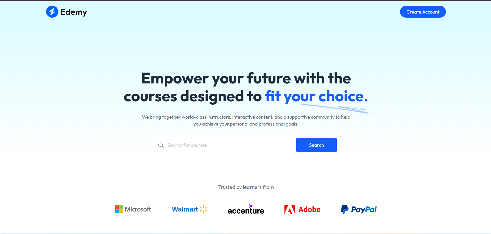
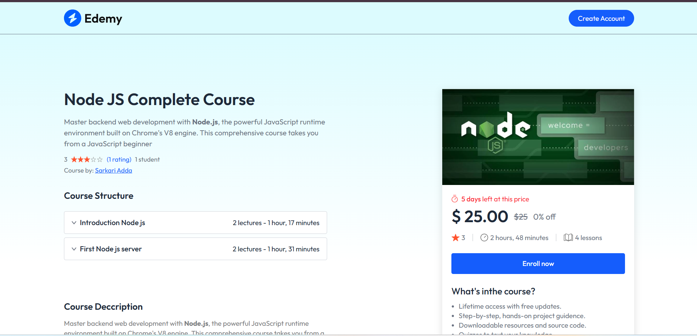
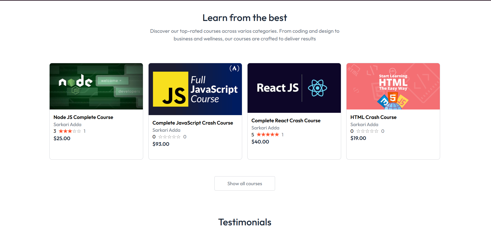
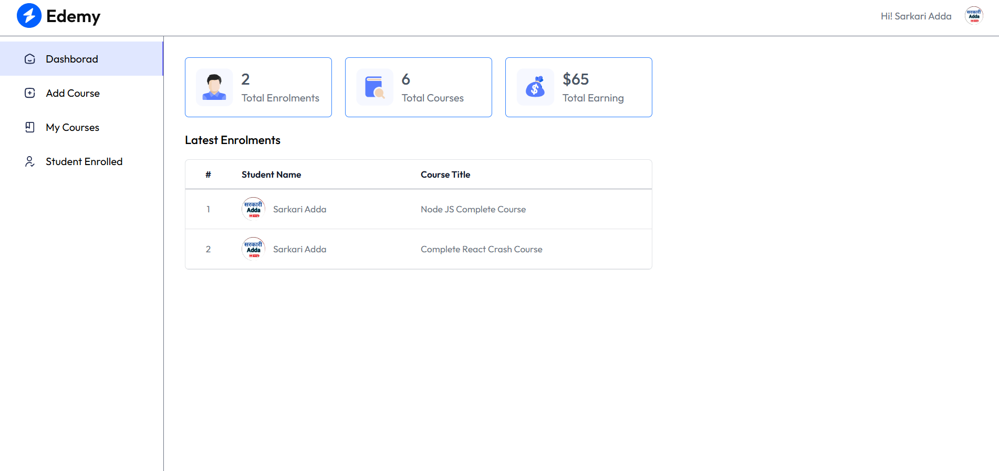
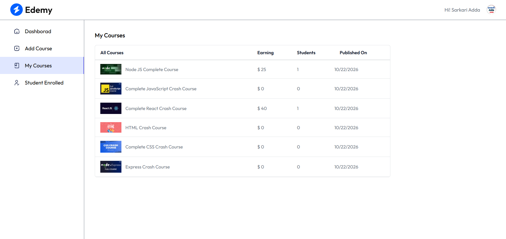
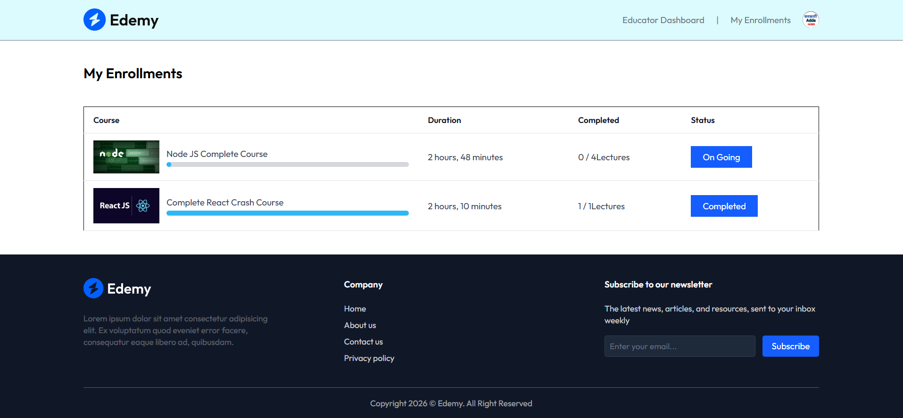
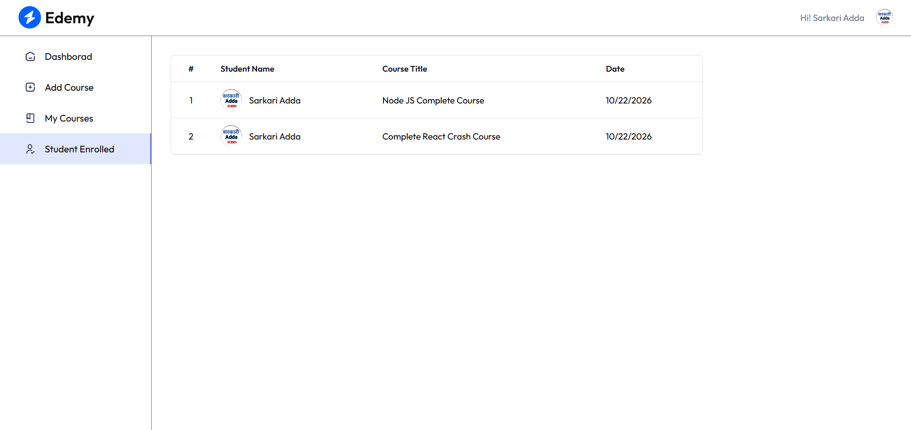

# 🎓 Edemy — Learning Management System (LMS)

A full-stack Learning Management System built to make online learning easier by connecting students with educational courses and providing educators with tools to manage their content.

🌐 **Live Demo:** [Visit Edemy LMS](https://learing-management-system-7j3t.vercel.app/)

💻 **GitHub Repository:** [View Source Code](https://github.com/udaypratap08/Learing-management-system)

---

## 📌 Table of Contents

- [Project Overview](#-project-overview)
- [Key Features](#-key-features)
- [Technology Stack](#-technology-stack)
- [Project Architecture](#-project-architecture)
- [Project Structure](#-project-structure)
- [Installation and Setup](#-installation-and-setup)
- [Environment Variables](#-environment-variables)
- [API Overview](#-api-overview)
- [Application Workflow](#-application-workflow)
- [Security](#-security)
- [Deployment](#-deployment)
- [What I Learned](#-what-i-learned)
- [Author](#-author)
- [Screenshots](#-Screenshots)

---

## 📖 Project Overview

**Edemy** is a web-based Learning Management System (LMS) developed to provide an online platform for course discovery, student enrollment, and educator course management.

The application uses a React frontend and a Node.js/Express backend connected to MongoDB. Clerk is used for authentication, Stripe supports payment integration, and Cloudinary provides cloud media storage.

The project demonstrates practical implementation of full-stack web development concepts, REST APIs, database integration, authentication, payment processing, and deployment.

### 🎯 Project Objectives

- Provide an accessible platform for online learning.
- Allow students to explore courses and manage their enrollments.
- Enable educators to manage courses.
- Integrate authentication and payment functionality.
- Build a responsive frontend connected to a backend API.

---


## Screenshots

### Home Page


### Course Details


### Courses


### Educator Dashboard


### Educator Courses


### Student Enrollments


### Student List



## ✨ Key Features

### 👨‍🎓 Student Features

- Browse and explore available courses.
- View individual course details.
- Authenticate using Clerk.
- Access enrollment-related functionality.
- View enrolled courses.
- Access course learning and progress functionality.

### 👨‍🏫 Educator Features

- Access the educator dashboard.
- Manage courses.
- Add new course content.
- View courses managed by the educator.
- Access student enrollment information.

### 🔐 Authentication

- Clerk-based authentication integration.
- Backend middleware for request authentication.
- Protected API functionality.
- Educator role detection and access-related functionality.

### 💳 Payment Integration

- Stripe payment integration.
- Backend payment webhook handling.
- Purchase-related database models.
- Support for payment-related workflows.

**Note:** Successful payments, webhook verification, and enrollment updates should be tested in Stripe test mode before claiming the complete payment workflow is production-ready.

### ☁️ Media Management

- Cloudinary integration for cloud-based media storage.
- Multer configuration for handling file uploads.

### 📊 Learning Progress

- Course progress data model.
- Course progress-related functionality.
- Student learning interface.

---

## 🛠️ Technology Stack

| Technology | Purpose |
|---|---|
| React.js | Building the user interface |
| JavaScript | Application logic |
| Node.js | Backend JavaScript runtime |
| Express.js | Backend server and REST APIs |
| MongoDB | Database |
| Mongoose | MongoDB data modeling |
| Clerk | Authentication |
| Stripe | Payment integration |
| Cloudinary | Cloud media storage |
| Multer | File upload handling |
| Axios | HTTP requests from the frontend |
| Vite | Frontend development and build tooling |
| Vercel | Deployment platform |

---

## 🏗️ Project Architecture

Edemy follows a frontend-backend architecture.

```text
                 ┌──────────────────────┐
                 │       Student        │
                 │       Educator       │
                 └──────────┬───────────┘
                            │
                            ▼
                 ┌──────────────────────┐
                 │    React Frontend    │
                 │   Vite + Axios       │
                 └──────────┬───────────┘
                            │
                       REST API
                            │
                            ▼
                 ┌──────────────────────┐
                 │   Express Backend    │
                 │   Node.js Server     │
                 └──────────┬───────────┘
                            │
             ┌──────────────┼──────────────┐
             │              │              │
             ▼              ▼              ▼
       ┌──────────┐   ┌──────────┐   ┌──────────┐
       │ MongoDB  │   │  Clerk   │   │  Stripe  │
       │ Database │   │   Auth   │   │ Payments │
       └──────────┘   └──────────┘   └──────────┘
                            │
                            ▼
                    ┌──────────────┐
                    │  Cloudinary  │
                    │ Media Storage│
                    └──────────────┘
```

### How It Works

1. A student or educator interacts with the React frontend.
2. The frontend sends HTTP requests to the Express backend.
3. The backend processes requests through routes, middleware, and controllers.
4. Mongoose models interact with MongoDB.
5. Clerk handles authentication integration.
6. Stripe handles payment-related operations.
7. Cloudinary provides cloud media storage.

---

## 📂 Project Structure

The repository is organized into separate frontend and backend applications.

```text
Learing-management-system/
│
├── client/
│   ├── src/
│   │   ├── components/
│   │   ├── pages/
│   │   ├── context/
│   │   └── App.jsx
│   │
│   ├── public/
│   ├── package.json
│   └── vite.config.js
│
├── server/
│   ├── configs/
│   │   ├── cloudinary.js
│   │   ├── mongodb.js
│   │   └── multer.js
│   │
│   ├── controllers/
│   │   ├── courseController.js
│   │   ├── educatorController.js
│   │   ├── userController.js
│   │   └── webhooks.js
│   │
│   ├── middlewares/
│   │   └── authMiddleware.js
│   │
│   ├── models/
│   │   ├── Course.js
│   │   ├── CourseProgress.js
│   │   ├── Purchase.js
│   │   └── User.js
│   │
│   ├── routes/
│   │   ├── courseRoute.js
│   │   ├── educatorRoutes.js
│   │   └── userRoutes.js
│   │
│   ├── server.js
│   ├── package.json
│   └── vercel.json
│
└── README.md
```

*The tree above summarizes the main project files; some supporting files may be omitted.*

### Important Backend Files

| File | Responsibility |
|---|---|
| `server.js` | Initializes Express, middleware, database connections, and routes |
| `configs/mongodb.js` | Configures the MongoDB connection |
| `configs/cloudinary.js` | Configures Cloudinary |
| `configs/multer.js` | Configures file upload handling |
| `models/Course.js` | Defines the course data model |
| `models/User.js` | Defines the user data model |
| `models/Purchase.js` | Defines purchase-related data |
| `models/CourseProgress.js` | Defines course progress data |
| `controllers/courseController.js` | Handles course-related business logic |
| `controllers/educatorController.js` | Handles educator-related operations |
| `controllers/userController.js` | Handles user-related operations |
| `controllers/webhooks.js` | Handles Clerk and Stripe webhook events |
| `routes/courseRoute.js` | Defines course API routes |
| `routes/educatorRoutes.js` | Defines educator API routes |
| `routes/userRoutes.js` | Defines user API routes |
| `middlewares/authMiddleware.js` | Contains authentication-related middleware |

---

## ⚙️ Installation and Setup

Follow these steps to run the project locally.

### Prerequisites

Install the following:

- Node.js and npm
- Git
- MongoDB access
- Clerk account and application credentials
- Cloudinary account and credentials
- Stripe account and API credentials

### Step 1: Clone the Repository

```bash
git clone https://github.com/udaypratap08/Learing-management-system.git
```

Navigate into the project:

```bash
cd Learing-management-system
```

### Step 2: Install Frontend Dependencies

```bash
cd client
npm install
```

Create the frontend environment file and configure the required variables.

Start the frontend development server:

```bash
npm run dev
```

### Step 3: Install Backend Dependencies

Open another terminal:

```bash
cd Learing-management-system/server
npm install
```

Create the backend environment file and configure the required variables.

Start the backend using the script defined in `server/package.json`. If the package defines a `dev` script, run:

```bash
npm run dev
```

Otherwise, use the start command defined by the project.

### Step 4: Verify the Backend

Once the backend is running, open:

```text
http://localhost:5000/
```

The root endpoint should return:

```text
API Working
```

The default port is `5000`, unless overridden by the `PORT` environment variable.

---

## 🔑 Environment Variables


### Frontend Configuration

Create a `.env` file inside `client/`:

```env
VITE_BACKEND_URL=http://localhost:5000/
VITE_CURRENCY=USD
```

- `VITE_BACKEND_URL`: Base URL of the backend API.
- `VITE_CURRENCY`: Currency configuration used by the frontend.

Add any other frontend variables required by the existing source code.

### Backend Configuration

Create a `.env` file inside `server/`.

The backend configuration may require variables similar to these:

```env
PORT=5000

# Database
MONGODB_URI=your_mongodb_connection_string

# Clerk
CLERK_SECRET_KEY=clerk_secret_key

# Cloudinary
CLOUDINARY_CLOUD_NAME=cloudinary_cloud_name
CLOUDINARY_API_KEY=cloudinary_api_key
CLOUDINARY_API_SECRET=cloudinary_api_secret

# Stripe
STRIPE_SECRET_KEY=stripe_secret_key
STRIPE_WEBHOOK_SECRET=stripe_webhook_secret
```

**Important:** These are illustrative variable names. Check the existing backend source code to confirm the exact variable names before running the application. Your project may require additional variables, such as a Clerk webhook secret or a frontend URL.

Use test credentials while developing and testing payment functionality.

---

## 🔌 API Overview

The backend uses Express routers to organize its API endpoints.

| Base Path | Purpose |
|---|---|
| `/` | Backend health check |
| `/api/course` | Course-related operations |
| `/api/educator` | Educator-related operations |
| `/api/user` | User-related operations |
| `/clerk` | Clerk webhook endpoint |
| `/stripe` | Stripe webhook endpoint |

### Example User Operations

The application includes user-related operations such as:

- Fetching user data.
- Fetching enrolled courses.
- Initiating a course purchase.

Example endpoint paths referenced in the application include:

```text
GET  /api/user/data
POST /api/user/purchase
```

The complete endpoints, HTTP methods, request bodies, and authentication requirements should be confirmed in the corresponding route files.

### Authentication

Protected API requests may require an authentication token.

Example Axios request:

```javascript
const token = await getToken();

const response = await axios.get(
  `${backendUrl}api/user/data`,
  {
    headers: {
      Authorization: `Bearer ${token}`
    }
  }
);
```

The exact request URL must match the backend base URL and route configuration.

---

## 🔄 Application Workflow

### 1. User Authentication

Clerk provides authentication integration. The frontend obtains the appropriate authentication token and sends it with protected API requests.

### 2. Course Management

The frontend requests course information through backend API endpoints. The backend processes requests and interacts with the course data model.

### 3. Student Enrollment

Students can access enrollment-related functionality. User and purchase-related backend operations support the enrollment workflow.

### 4. Payment Processing

Stripe supports payment-related operations. The backend includes a webhook endpoint to receive Stripe events.

Webhook events should be signature-verified, and payment status should be validated before updating purchase or enrollment records.

### 5. Media Uploads

Multer handles incoming file uploads, while Cloudinary provides cloud-based media storage.

### 6. Course Progress

The course progress model provides a structure for storing student learning progress.

---

## 🔒 Security

Security is an important part of a full-stack application.

Recommended production practices include:

- Keep secret keys in environment variables.
- Never expose backend secret keys in frontend code.
- Validate authentication tokens on protected endpoints.
- Apply educator-role checks where required.
- Validate and sanitize incoming request data.
- Verify Stripe webhook signatures.
- Configure CORS for trusted frontend origins.
- Validate uploaded files and restrict acceptable file types and sizes.
- Handle errors without exposing sensitive information.
- Use HTTPS for deployed applications.
- Avoid logging secrets or sensitive user information.

These are security practices to verify and enforce; listing them here does not imply that every item has already been implemented.

---

## 🚀 Deployment

The project has been deployed on Vercel.

**Live Application:**  
https://learing-management-system-7j3t.vercel.app/

**Source Code:**  
https://github.com/udaypratap08/Learing-management-system

For a successful deployment, ensure that:

1. Frontend and backend environment variables are configured correctly.
2. The frontend points to the deployed backend API.
3. The backend can connect to MongoDB.
4. Clerk and Cloudinary credentials are valid.
5. Stripe test or live configuration matches the intended environment.
6. Webhook endpoints are configured with the correct URL and secrets.
7. Cross-origin requests are configured correctly.

---


## 📚 What I Learned

Building this project helped me practice and understand:

- Full-stack application architecture.
- React component-based development.
- REST API integration.
- Express routing, middleware, and controllers.
- MongoDB database integration and Mongoose models.
- Authentication integration using Clerk.
- Payment integration concepts using Stripe.
- File upload handling and Cloudinary integration.
- Environment variable configuration.
- Deployment and debugging of a full-stack application.

---

## 👨‍💻 Author

**UDAY PRATAP**

Full-Stack Web Development Learner

I enjoy building web applications and improving my skills in frontend development, backend APIs, databases, and application deployment.

### Connect With Me

- **GitHub:** [udaypratap08](https://github.com/udaypratap08)
- **LinkedIn:** https://www.linkedin.com/in/udaypratap12/.
- **Portfolio:** https://udaypratap-portfolio-iota.vercel.app/.

---

## ⭐ Support

If you find this project interesting, consider giving the repository a ⭐ on GitHub.

Feedback and suggestions for improvement are always welcome!

---

**Built with dedication as a full-stack web development project.**